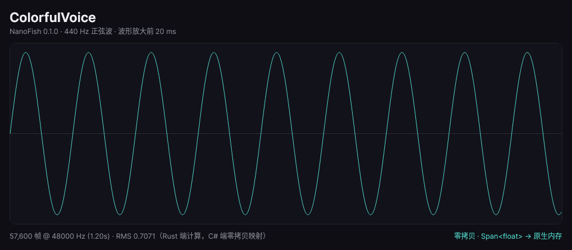
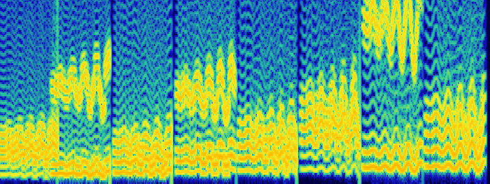
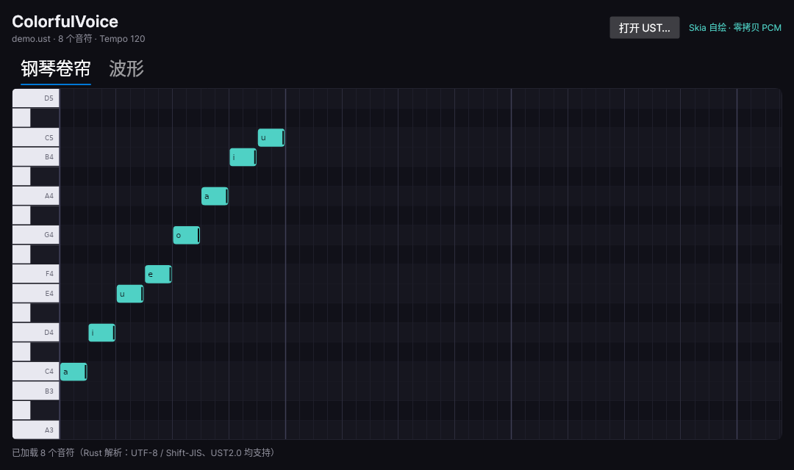
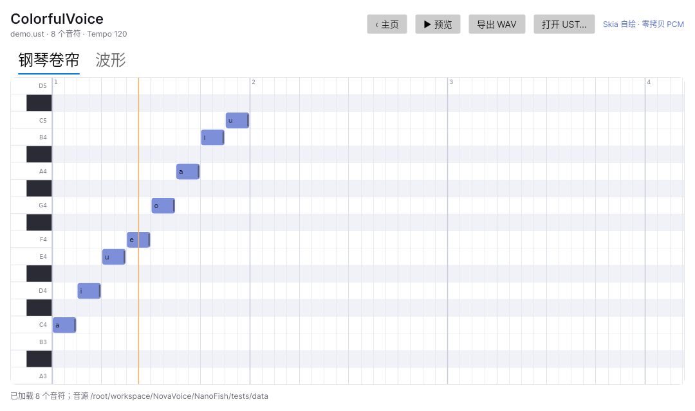
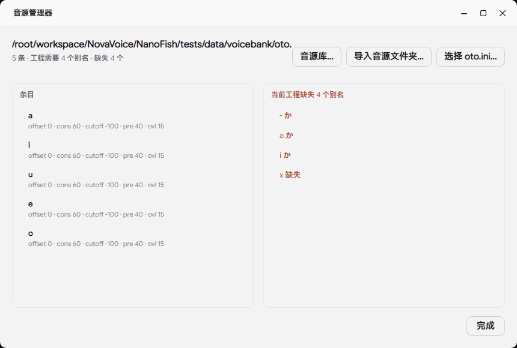
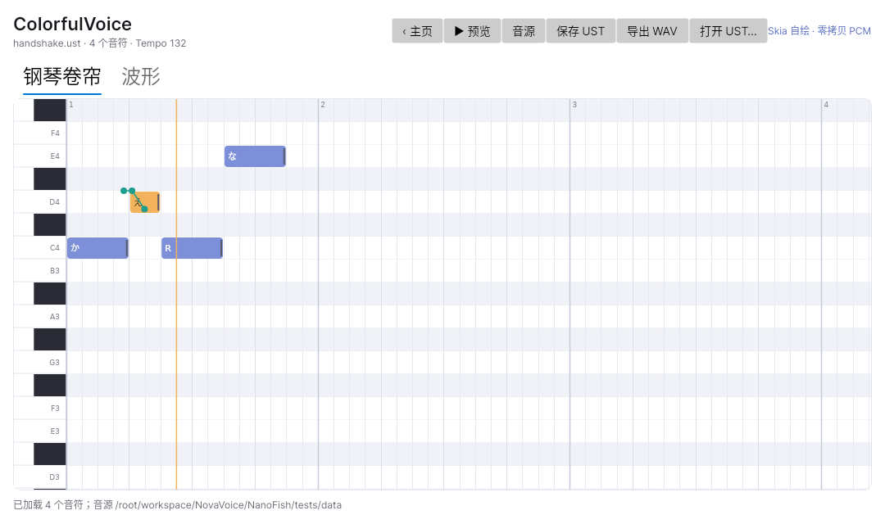
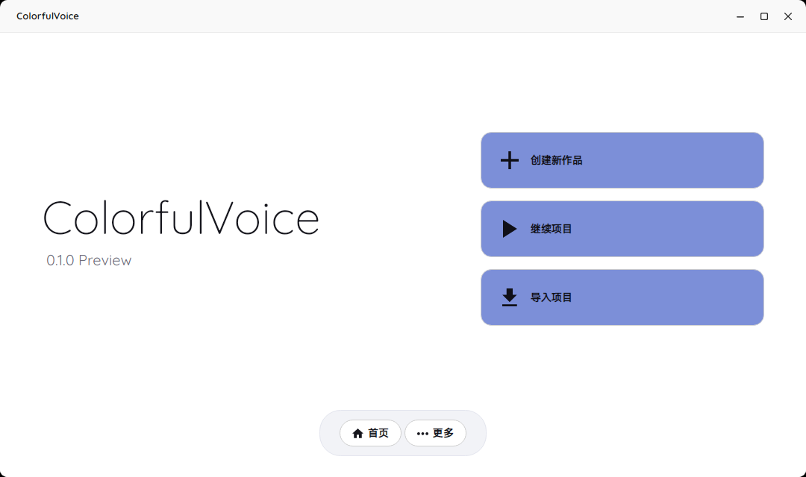
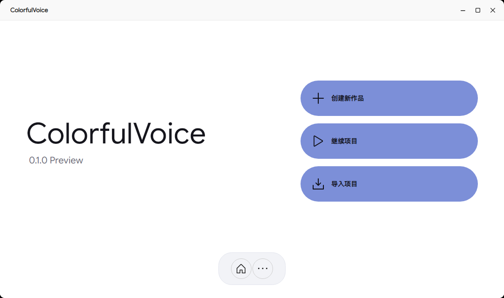
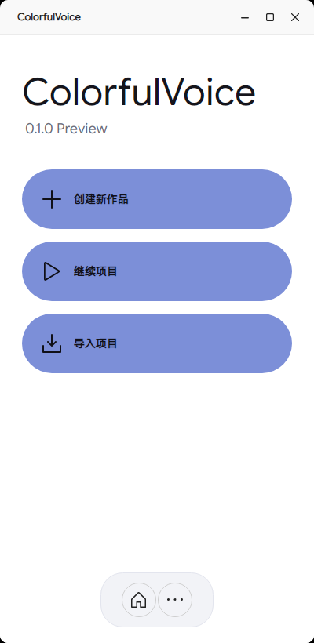

# ColorfulVoice

引擎与宿主绝对分离的歌声合成器：

- **NanoFish**（Rust，`cdylib` + `rlib`）：纯 DSP 计算与 C ABI 导出，不认识任何 UI。
- **ColorfulVoice**（Avalonia / C#）：Skia 自绘 UI 与业务逻辑，通过 P/Invoke 直接映射 Rust 内存。

```
工作区/
├── NanoFish/                  # Rust 引擎（独立仓库）
│   ├── src/audio.rs           # 纯计算层（正弦波 / RMS，rayon 并行）
│   ├── src/ffi.rs             # C ABI：指针 + 长度，所有权交给宿主
│   ├── src/player.rs          # 原生播放器（miniaudio，null 后端回退）
│   ├── src/audio_shim.c       # miniaudio C 封装（环形缓冲 + 设备回调）
│   ├── src/dsp.rs             # WSOLA 时间缩放 + 线性重采样变调 + 汉宁交叉淡化
│   ├── src/render.rs          # UST + oto + 采样 → PCM（切片 / 变速 / 摆放 / 归一化）
│   ├── src/voicebank.rs       # 音素器（CV/VCV/CVVC、注音、presamp）
│   ├── src/ust.rs / oto.rs    # UST 与 oto.ini 解析
│   ├── include/nanofish.h     # C 头文件（与 ffi.rs 同步）
│   └── scripts/               # Android 交叉编译
└── ColorfulVoice/             # 本仓库
    ├── src/NanoFish.Interop/  # P/Invoke + AudioBuffer(IDisposable) + Span<float>
    ├── src/ColorfulVoice.UI/  # 共享 UI 库（App/主页/卷帘/波形）
    ├── src/ColorfulVoice.App/ # 桌面头（Avalonia.Desktop）
    ├── src/ColorfulVoice.Android/
    ├── tests/ColorfulVoice.Headless/
    ├── docs/                  # 截图与 Android 说明
    ├── docker/                # Android 打包环境
    └── scripts/               # build.sh / sync-native.sh
```

## 零拷贝契约

```
Rust                                   C#
NfAudioBuffer { data, len, cap }  →    out NfAudioBufferNative
   ↑ 堆内存（Vec<f32>）                  Span<float>((void*)Data, len)   // 只读映射
   └── nanofish_free_audio()       ←    AudioBuffer.Dispose()
```

规则：

1. **谁分配谁释放**：`data` 永远由 Rust 分配、由 `nanofish_free_audio` 释放；C# 绝不 `free`。
2. 返回后宿主立刻拿到 `Span<float>`，**不复制**；`GC.AddMemoryPressure(len * 4)` 让 GC 感知非托管占用。
3. `AudioBuffer` 实现 `IDisposable`，`Dispose` 后再访问 `Samples` 抛 `ObjectDisposedException`；
   `Dispose` 幂等，重复调用安全（Rust 端把结构体清零）。
4. 参数非法时返回错误码而不是 panic——`panic = "abort"`，任何 unwind 跨 FFI 都是致命的。

## 构建与验证

```bash
# 依赖：Rust 1.75+、gcc、.NET 8 SDK
scripts/build.sh            # 编译 Rust + 所有 C# 项目 + 同步 libnanofish.so

# 1) Rust 单测
cargo test --manifest-path ../NanoFish/Cargo.toml

# 2) C ABI 冒烟测试
cd NanoFish && cargo build --release
gcc tests/ffi_smoke.c -Iinclude -Ltarget/release -lnanofish \
    -Wl,-rpath,'$ORIGIN/release' -o target/ffi_smoke && ./target/ffi_smoke

# 3) C# 端到端零拷贝验证
dotnet run --project tests/NanoFish.Smoke

# 4) 宿主 UI
dotnet run --project src/ColorfulVoice.App
```

引擎库查找顺序：`NANOFISH_LIB` 环境变量 → 程序目录（`libnanofish.so`）→ 系统默认路径。
`sync-native.sh` 会把 `.so` 复制进每个 `bin/*/net8.0`，因此默认无需设置 `LD_LIBRARY_PATH`。

## 里程碑状态

| 阶段 | 内容 | 状态 |
| :-- | :-- | :-- |
| Phase 0.1 | NanoFish 骨架：正弦波 + free + C 头文件 | ✅ 单测 / C 冒烟通过 |
| Phase 0.2 | ColorfulVoice 骨架 + Span 零拷贝验证 | ✅ 端到端通过 |
| Phase 0.3 | rayon 分块并行（分块间相位连续） | ✅ 1.70x（8 线程） |
| Phase 1.1 | UST / oto.ini 解析（含 Shift-JIS、UST2.0） | ✅ 25 项测试通过 |
| Phase 1.2 | 变调 / 时间拉伸 / 交叉淡化 / 命令行出 WAV | ✅ 39 项测试通过 |
| Phase 1.3 | Envelope 作用到音频（DYN/MOD 待接入） | 🟡 部分完成 |
| Phase 2.2 | Skia 钢琴卷帘：绘制 / 拖拽 / 缩放 | 🟡 基础交互完成 |
| Phase 2.1 | 工程管理：打开 / 保存 UST、音源管理器 | ✅ 完成 |
| Phase 2.3 | PIT/PBS 曲线：显示 / 拖点 / 双击创建 | 🟡 基础完成 |
| Phase 2.4 | 播放：miniaudio 原生输出 + 播放头跟随 + 导出 WAV | ✅ 端到端通过 |
| Phase 3.1 | Android 交叉编译（arm64 .so） | ✅ 工具链打通 |
| Phase 3.2 | ONNX 共振峰推理（tract，纯 Rust） | ✅ 占位模型 + FFI |
| Phase 3.3 | 移动端触控：双指缩放/平移、单指拖动、16px 热区 | ✅ 基本完成 |
| Phase 4 | .deb 打包、卓易通实测 | ⏳ 未开始 |

## Phase 0 实测结果

在 Android proot / aarch64（8 线程）上：

| 验证项 | 结果 |
| :-- | :-- |
| Rust 单测（含并行分块一致性） | 7/7 通过 |
| C ABI 冒烟测试（gcc 链接 `libnanofish.so`） | 通过，12000 帧 / peak 1.0000 / RMS 0.7071 |
| C# 零拷贝握手 | 11 项检查全部通过，`Span<float>` 直达原生堆 |
| 非托管泄漏（2000 次生成/释放） | RSS +0.8 MiB（未释放将为 +38 MiB） |
| rayon 并行（10s / 480k 样本） | 16.38 ms → 9.64 ms，**1.70x**，逐样本一致 |
| Avalonia 界面（无头 Skia 渲染） | 见 [`docs/phase0-window.png`](docs/phase0-window.png) |



无显示器环境下验证 UI：

```bash
dotnet run -c Release --project tests/ColorfulVoice.Headless -- docs/phase0-window.png
```

## 解析层用法

```bash
cargo run --bin nanofish-cli -- ust tests/data/handshake.ust
cargo run --bin nanofish-cli -- oto tests/data/oto.ini
```

输出示例：

```
UST: tests/data/handshake.ust
  编码      : utf-8
  版本      : UST Version1.2
  工程      : 握手测试  Tempo=132  Tracks=1  Mode2=true
  音符      : 4 个（休止 1），1680 tick ≈ 3.50 拍 ≈ 1.59 秒
```

实现要点：

- **两种位置语义**：旧版 `Length` 紧接上一音符结束；UST 2.0 用 `Delta`（相对上一音符**起点**）+ `Duration`。
- **音高曲线**：`PBS=x;y` 给起点，`PBW` 给每段宽度，`PBY` 给拐点音高，`PBM`（`r`/`s`/`j`）按**点**下标给形状；`PitchBend::points()` 展开成绝对坐标。
- **包络**：`p1..p3, v1..v3, v4`，可带 `%`，扩展段 `p4,p5,v5` 保留为 `Option`。
- **容错**：未知键进 `extras`、坏行进 `warnings`，只有结构性错误才返回 `UstError`（带行号）。
- **编码**：UTF-8 失败自动回退 Shift-JIS，`project.encoding` 记录实际编码。
- 尚未实现：`.frq` 二进制读取（Phase 1.2 接 resampler 时补）。

## 渲染管线（Phase 1.2）

```bash
cargo run --release --bin nanofish-cli -- \
  render tests/data/demo.ust tests/data/voicebank/oto.ini ../docs/demo.wav
```

```
渲染完成: ../docs/demo.wav
  音源目录: tests/data/voicebank
  采样率  : 48000 Hz  时长: 2.00s  已渲染 8 个音符（跳过 0）
```

每个音符的处理顺序：

1. 由**音素器**解析别名（CV/VCV/CVVC：结合上一音符元音，如 `ka → - a`、`ki → a ki`），
   再取 `offset` / `cutoff` 切片（cutoff 为负时从末尾算）；
2. 音符音高相对 `origin_note`（默认 C4）算频率倍率 `2^(semitone/12)`；
3. 时间缩放用 **WSOLA**：30ms 帧、50% 重叠，每次在理论位置 ±5ms 内按波形相似度
   对齐，大倍率压缩时也不会把颤音音源的相位叠散；
4. 用线性重采样把音高乘上目标倍率（同时把长度压回去）；
5. 按 tick 摆放（元音起点对齐音符，辅音提前 `preutterance`），
   交界处用 `overlap` 毫秒的汉宁窗淡入淡出；
6. 整体峰值超过 0.99 时统一缩放，不硬削波。



> 频谱图由 `scripts/spectrogram.py`（纯标准库，无需 numpy）生成；8 段对应 8 个
> 元音音符，可见共振峰随 a/i/u/e/o 变化。

**已知限制（Phase 1.3 处理）**：

- UST 的 `Envelope` 已按 ADSR 解读作用到音频，`VBR`（颤音）仍是只解析；
- 每音符只用一个别名，CV/VCV 的多音素拼接还没做；
- 变调是线性重采样，降采样没有抗混叠滤波；
- DYN（音量）与 MOD（颤音）还没有接入，音质仍在"能听出旋律"级别，离成品还有调参空间。

## 钢琴卷帘（Phase 2.2）



交互按 PaintVoice 的习惯设计：

| 操作 | 行为 |
| :-- | :-- |
| 空白处按下并拖拽 | 直接画出音符，拖动决定时值 |
| 拖音符本体 | 移动，吸附 1/4 拍 + 半音 |
| 拖音符右边缘 | 改时值（右边缘有深色把手） |
| Shift+拖拽空白 | 框选多个音符 |
| Ctrl+点音符 | 加选 / 减选 |
| Delete / Backspace | 删除选中 |
| Ctrl+A / C / V | 全选 / 复制 / 粘贴（粘贴后错开一拍） |
| Ctrl+Z / Ctrl+Y | 撤销 / 重做 |
| Esc | 取消选择 |
| 双指捏合 / Ctrl+滚轮 | 横向缩放（以光标为锚点） |
| 滚轮 / 双指拖动 | 纵向滚动 / 平移 |
| Shift+滚轮 | 横向滚动 |

实现要点：

- **不用 `ItemsControl`**：所有可见音符在一次 `Render` 里提交，只画落在视口内的；
- 坐标与吸附逻辑抽成纯类 `PianoRollLayout`，命中测试 / tick 往返 / 缩放锚点都有自检；
- 文本按 `(歌词, 字号)` 缓存 `FormattedText`，避免每帧重建。

```bash
# 几何自检（无需显示器）
dotnet run -c Release --project tests/ColorfulVoice.Headless -- --self-test
# 无头渲染截图
dotnet run -c Release --project tests/ColorfulVoice.Headless -- docs/pianoroll.png
```

**打开 UST**：右上角按钮 → 文件选择器 → Rust 解析（UTF-8 / Shift-JIS、UST2.0）→ FFI 返回扁平音符表 → 卷帘渲染。
音符表通过 `NfNote { start_tick, length_ticks, note_num, flags, lyric[64] }` 传递，
`nanofish_load_ust` 分配、`nanofish_free_ust` 释放，C# 侧读完立即归还。

**播放预览**：右上角「▶ 预览」或 Space 启停播放头，按工程 BPM 推进（`TicksForMs` 公式有自检），
播放头跑出视口会自动横向跟随；音频输出留到 Phase 2.4 接 NAudio / Oboe。



**保存 UST**：解析时每个音符会保留原始 `key=value` 行；保存时以 UST 2.0 的
`Delta + Duration` 重写位置，其余字段（`PBS/PBW/PBY/PBM`、`Envelope`、`VBR`、
`Velocity`、`Flags`…）**原样写回**，不会因为 UI 只编辑了基础属性而丢数据。

```bash
dotnet run -c Release --project tests/ColorfulVoice.Headless -- --save-test
# 加载: 4 个音符, tempo 132
# 重载: 4 个音符
# 保存往返 OK（PBS/Envelope 保留）
```

## 音源管理器（Phase 2.1）



- 选择/切换 `oto.ini`，列出全部条目与 offset / consonant / cutoff / pre / overlap；
- 自动对比当前工程歌词，标出**缺失别名**（截图里 `x 缺失`）；
- 选完立即用于试听与渲染（会丢弃旧的渲染缓存）。

窄屏下工具栏只保留「主页 / 预览 / ⋯」，其余操作收进 ⋯ 菜单（音源、保存、导出、打开）。

## 音高曲线（Phase 2.3）



- 双击音符生成一条平直曲线（两个端点）；拖动圆点上下调整半音（吸附 1/2 半音，范围 ±24）；
- 曲线按 `PBS/PBW/PBY/PBM` 语义解析成绝对点，绘制覆盖在音符上；
- 保存时用 `PitchCurve.ReplaceLines()` 重写这四行，`Envelope/VBR` 等其它字段不受影响；
- 往返测试：`--pitch-test`（解析 → 重写 → 再解析，并确认 `Envelope` 仍在）。

尚未实现：增删曲线点、切换 s/r/j 形状、曲线跨音符延续、60fps 压测、歌词输入法编辑、音源选择持久化。

## 字体

| 用途 | 字体 | 来源 |
| :-- | :-- | :-- |
| 拉丁/标题 | **Google Sans Flex**（可变字体） | [googlefonts/googlesans-flex](https://github.com/googlefonts/googlesans-flex) v5.000（OFL） |
| 中文 | **思源黑体 / Noto Sans SC**（静态 Regular） | [notofonts/noto-cjk](https://github.com/notofonts/noto-cjk)（OFL） |

- 文件放在 `ColorfulVoice.UI/Assets/Fonts/`，以 `AvaloniaResource` 嵌入；
- 字体通过 SukiUI 官方入口设置：`App.axaml` 的 `Application.Resources` 里覆盖
  `DefaultFontFamily`（见 [SukiUI 自定义字体文档](https://kikipoulet.github.io/SukiUI/zh/documentation/faq/custom-font.html)）；
- 使用的是 **静态实例**（fonttools 从可变字体 `wght=400` 实例化），避免 Android 上可变字体不生效。

## UI 技术栈

| 层 | 选型 |
| :-- | :-- |
| UI 框架 | **Avalonia 11.3.14**（C#/.NET 8） |
| 主题/控件库 | **SukiUI 6.1.1**（`SukiTheme` + `SukiWindow`），浅色变体 |
| 渲染 | Avalonia + Skia；钢琴卷帘/波形是自绘 `Control` |
| 引擎 | Rust `libnanofish`，P/Invoke + `Span<float>` 零拷贝 |

接入方式：`App.axaml` 里 `<suki:SukiTheme ThemeColor="Blue" />`，
窗口类型换成 `SukiWindow`（桌面主窗口、音源管理器、项目列表）。



## P0 完成情况（2026-11-17）

| 条目 | 状态 |
| :-- | :-- |
| CVVC 的 VC+CV 切分（按 preutterance 分配） | ✅ 引擎，含单测 |
| presamp.ini `[REPLACE]` | ✅ 引擎 |
| Velocity / Intensity → 增益，Modulation → 颤音深度 | ✅ 引擎 |
| 批量歌词对话框 | ✅ UI（更多 → 批量歌词…） |
| 音符属性面板（歌词/音高/时值/力度） | ✅ UI（双击音符） |
| 音源库扫描面板 | ✅ UI（音源管理器 → 音源库…） |
| 颤音 UI（深度/周期 → `VBR=`） | ✅ 音符属性面板 |
| 呼吸音开关（`br`，全局） | ✅ 更多菜单，写入 `nanofish_set_breath_alias` |
| 表情音源 UI 开关 | ⏳ 引擎就绪，界面未接 |
| っ 促音 | ✅ 优先 `cl`/`っ` 别名，缺失时退回 `cl` |

## 歌词写法与音素器

| 写法 | 示例 | 解析 |
| :-- | :-- | :-- |
| 罗马音 | `ka` `shi` `kya` | 先转平假名再取尾音元音（`kya`→a） |
| 平假名 / 片假名 | `か` `キミ` | 取最后一个假名的元音，片假名自动归一化 |
| 长音 | `きー` `コーヒー` | 末尾 `ー` 沿用前一假名的元音 |
| 促音 | `っか` | 元音取 `か` 的 a（不额外拉长辅音，见下） |
| 汉字注音 | `歌(うた)` `君[きみ]` | 用括号内读音 |
| 延续 | `+` | 沿用上一个音符的歌词 |
| 休止 | `R` / 空 | 只推进时间，可配 `breath_alias` 插呼吸 |
| 拨音 | `ん` | 元音按 `n` 处理 |

别名匹配现在会**交叉尝试假名与罗马音**：注音写假名、音源别名是罗马音（或反之）也能命中；
候选顺序覆盖 VCV → CVVC → CV，不再依赖音源类型检测。

**仍缺（对照 OpenUtau）**：真正的 CVVC 音素切分（VC + CV 两段、按 preutterance 分配时间）、
`presamp.ini`（[VOWEL]/[REPLACE]/[PRIORITY]）、音素提示 `[a ki]`、长音/促音的时长处理、
`ん` 的同化（m/ŋ）、英文 ARPAsing/VCCV、中文拼音 CVV、多语言音素器。

## 多轨 / 变速 / 表情 / 颤动（引擎侧）

| 能力 | API | 说明 |
| :-- | :-- | :-- |
| 多音源库 | `library::scan(root)` | 扫描目录下所有含 `oto.ini` 的音源，返回名称/类型/别名数 |
| 多 Vocal 并行 | `song::render_tracks(&[Track])` | 每轨独立音源与增益（`Track::gain`），混音后统一归一化 |
| 速度调节 | `tempo::TempoMap` | 支持曲中变速（音符 `Tempo` 字段），tick→采样按事件分段积分 |
| 歌词解析 | `lyrics::split` / `lyrics::assign` | 按空白与常见标点切分，跳过休止符依次写入 |
| 表情声源 | `Track::expression` | 同一轨叠加另一套音源，按比例混入 |
| 颤音 | `dsp::apply_vibrato` | 由 `VBR` 映射（速率/深度/淡入淡出/相位），调制重采样不改时长 |
| 呼吸 | `RenderOptions::breath_alias` | 休止处插入呼吸音，自动淡入淡出 |

> UI 侧尚未接这些开关（下一轮做音源库面板、轨列表、Tempo/颤音编辑）。

## 主页与播放（Phase 2.4）

默认浅色主题（白底）。主页按宽度自适应：

| 宽度 | 布局 |
| :-- | :-- |
| ≥ 760px | 左侧大标题 + 右侧竖排三个按钮（桌面） |
| < 760px | 标题在上、按钮整行铺满（手机 / 小窗口），与手绘稿一致 |





三个入口：**创建新作品** / **继续项目** / **导入项目**（唯一的 UST 打开入口）。
底部胶囊只有 **首页** 与 **更多** 两项，**音源管理**放在「更多」里。

### 信息架构

| 位置 | 内容 |
| :-- | :-- |
| 首页按钮 | 创建新作品 / 继续项目 / 导入项目 |
| 首页胶囊 | 首页 · 更多（音源管理…） |
| 继续项目 | 最近工程列表，每项 `⋯` 二级菜单：打开 / **导出 WAV…** / 从列表移除 |
| 编辑器工具栏 | ‹ 主页 · ▶ 预览 · 保存 UST · ⋯（音源管理器…、保存 UST） |

> 编辑器里不再提供「打开 UST」，打开工程只能从首页「导入项目」进入；
> WAV 导出移到「继续项目」列表的二级菜单。
编辑器在窄屏下工具栏会自动换到标题下方，装饰性徽标隐藏；窗口最小尺寸 360×480。

播放链路：

```
C# 预览按钮
  → NanoFish.RenderUst(ust, oto, voice_dir)   # Rust 渲染成 PCM
  → AudioPlayback（miniaudio 设备，环形缓冲）
  → 设备时钟 position → 播放头 tick（tempo/60*480）
```

- 音频后端用 **miniaudio**（单头文件，vendored；桌面走 WASAPI/CoreAudio/ALSA，Android 走 AAudio）；
- 无声卡时自动回退 **null 后端**：回调仍按真实时钟推进，所以播放头与队列逻辑可测；
- 环形缓冲 500ms，UI 每 16ms `Pump()` 补数据；
- 「导出 WAV」把渲染结果写成 16-bit 单声道 PCM。

自动化验证：

```bash
dotnet run -c Release --project tests/ColorfulVoice.Headless -- --audio-test
# 渲染: 96000 帧 @ 48000 Hz (RMS 0.282)
# 后端: 真实设备 / null（无声卡）
# 已播: 0.250s ...
# 音频链路 OK
```

## Android 打包（Phase 3.1）

工程已拆成 **共享 UI 库 + 桌面头 + Android 头**：

```
ColorfulVoice.UI        Avalonia 界面（App/MainWindow/Controls/Views）
ColorfulVoice.App       桌面入口（Avalonia.Desktop）
ColorfulVoice.Android   Android 入口（Avalonia.Android，MainActivity + Manifest）
```

打包脚本：`scripts/build-android.sh`（cargo-ndk 交叉编译 arm64-v8a → `dotnet publish` 出 APK）。

**当前机器的阻塞**（已实测）：

- `build-tools/34.0.0/aapt2` 是 `ELF 64-bit LSB pie executable, x86-64`，在 arm64 上直接
  `cannot execute`；
- NDK 的 clang 同样只提供 `linux-x86_64` 预编译；
- Ubuntu 版 .NET SDK 不认 `android` workload（`Workload ID android is not recognized`）。

所以 APK 必须在 x86_64 宿主上打。仓库里给了 `docker/Dockerfile.android`，在任意
有 Docker 的机器上：

```bash
docker build -f docker/Dockerfile.android -t colorfulvoice-android .
docker run --rm -v "$PWD":/src colorfulvoice-android ./scripts/build-android.sh
```

## 音源导入与音素器（Phase 2.1+）

- 音源管理器新增「导入音源文件夹…」：选一个含 `oto.ini` 的 UTAU 音源目录即可
- 读取 `character.txt` 的 `name` / `image` / `author`
- 自动识别音源类型：存在 `- a` 别名 → **VCV**；存在 `a k` → **CVVC**；否则 **CV**
- 音素器按「上一个音符的元音 + 当前歌词」生成候选别名，逐个查表：
  - VCV：`a ki` → `- a` → `ki`
  - CV：`ki`，退回到元音 `i`
- 界面上会显示「音素预览」：`か→- a · き→a ki …`

对应 C ABI：`nanofish_voicebank_open / _info / _resolve / _free`。

> 本机（Android proot / aarch64）说明：apt 版 rustc 为 1.75，`rayon` 需锁定 `1.10.0`
> + `rayon-core 1.12.1`（见 `Cargo.lock`），否则最新 `rayon-core` 要求 rustc ≥ 1.80。